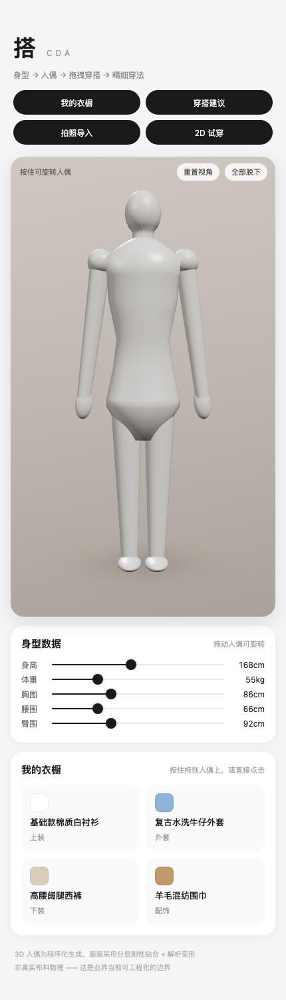
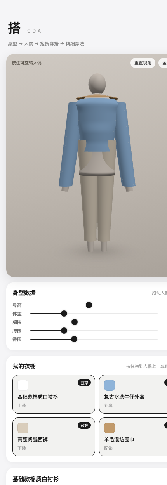
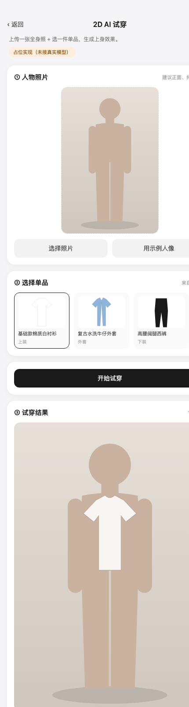
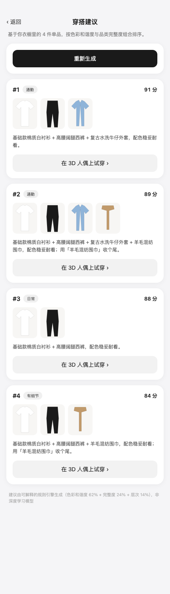
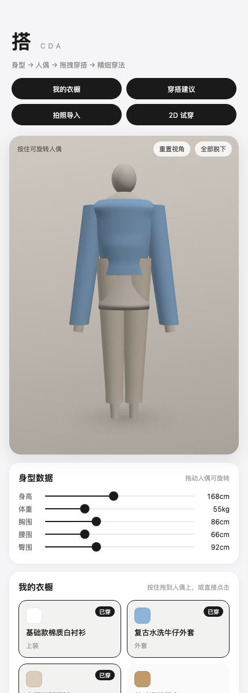

# 搭 · CDA

服装穿搭 App 原型。核心是把「用户已有单品 → 3D 人偶 → 拖拽穿搭 → 精细穿法」这条链路跑通。

当前状态：**Phase 0 技术验证完成**，H5 可跑，3D 人偶与服装壳层均能渲染。




---

## ⚠️ 环境前置：必须使用官方 Node，不能用 DSH 自带的

**这是本项目最容易踩的坑，务必先读。**

DSH（DeepSeek Harness）自带的 Node 是 Electron 派生的二进制，带 macOS 硬化运行时签名，且**没有** `com.apple.security.cs.disable-library-validation` 授权：

```
TeamIdentifier=NAN929V4UM   flags=0x10000(runtime)
```

后果：**任何第三方原生模块都无法加载**，报错形如

```
code signature ... not valid for use in process:
mapping process and mapped file (non-platform) have different Team IDs
```

而 Vite / Rollup / esbuild 全都依赖原生二进制。更坑的是 Rollup 会把真实原因吞掉，伪装成
`Cannot find module @rollup/rollup-darwin-arm64. npm has a bug related to optional dependencies`
—— 这会让人误以为是 pnpm 的问题，浪费大量时间。

**解决办法**：用官方 Node（带 `disable-library-validation` 授权）。

```bash
cd /Users/harmony/Desktop/dsh2
mkdir -p .tools && cd .tools
curl -L -o node.tar.gz https://nodejs.org/dist/v24.21.0/node-v24.21.0-darwin-arm64.tar.gz
tar -xzf node.tar.gz && rm node.tar.gz
ln -sfn node-v24.21.0-darwin-arm64 node

# 每次开新终端都要先做这一步
export PATH="/Users/harmony/Desktop/dsh2/.tools/node/bin:$PATH"
node -v   # 应输出 v24.21.0 且 `which node` 指向 .tools
```

验证授权是否到位：

```bash
codesign -d --entitlements - "$(which node)" 2>/dev/null | grep disable-library-validation
```

---

## 快速开始

```bash
# .tools/bin 提供 pnpm 命令包装（见下方说明），必不可少
export PATH="/Users/harmony/Desktop/dsh2/.tools/bin:/Users/harmony/Desktop/dsh2/.tools/node/bin:$PATH"
cd /Users/harmony/Desktop/dsh2/cda

# 首次安装依赖。注意：pnpm 11 默认拦截构建脚本，
# pnpm-workspace.yaml 里的 allowBuilds 已放行 esbuild，勿删。
pnpm install

# 启动 H5 开发服务器
pnpm dev          # → http://127.0.0.1:5173/
```

构建与小程序：

```bash
pnpm build                 # H5 生产构建
pnpm dev:mp                # 微信小程序（Phase 2，需要微信开发者工具）
```

---

## 目录结构

```
cda/
├── packages/
│   ├── core/              # 领域模型 + 本地假数据（demo 阶段不接后端）
│   │   └── src/types.ts   # ⭐ 三个亮点直接建模进类型系统
│   └── tryon-engine/      # 3D 试穿引擎（平台无关）
│       ├── src/platform.ts  # ⭐ 平台适配层：隔离 DOM，小程序兼容的关键
│       ├── src/body.ts      # 参数化人偶：身型数据 → 几何
│       ├── src/garment.ts   # 服装壳层 + 精细穿法（解析变形）
│       └── src/engine.ts    # 引擎门面：场景/相机/帧循环/图层管理
├── apps/
│   └── client/            # uni-app（Vue3 + TS），编译到 H5 / 小程序 / App
│       └── src/platform/stage.ts  # 取 canvas 的宿主适配（H5 已实现）
└── docs/screenshots/
```

---

## 核心设计决策

### 1. 为什么不用 SMPL / MHR 等真实人体模型

| 原因 | 说明 |
|---|---|
| License | SMPL / SMPL-X / STAR 是**科研许可**，商用要付费 |
| 体积 | MHR 权重较大，原型阶段没必要 |
| 网络 | 本机 `huggingface.co` **被阻断**，模型下载不可靠 |

因此改用**程序化人偶**：躯干由横截面椭圆环放样而成，每个环的半径直接由身高体重三围推导。
好处是零外部资源、秒级生成，且「拖身型滑杆 → 人偶立刻变形」这条链路演示效果非常直观。
将来若接入真实模型，只需替换 `body.ts` 的 `buildMannequin`，接口不变。

### 2. 为什么服装不做布料物理

业界目前**没有工程化方案**能真实模拟「扣子扣几颗 / 披着 vs 穿着 / 围脖子 / 系腰」。
真实布料 + 自碰撞 + 固件约束在手机 60fps 上做不到。

采用的降级策略（`garment.ts`）：

- **分层刚性贴合**：服装 = 身体截面 + 径向偏移，天然贴合、永不穿模
- **解析变形**：用顶点位移表达式表达穿法，而非 morph target —— 因为「扣几颗扣子」是**连续量**，做成 N 个 morph 会爆炸
- 效果「看着对」，但不是物理正确

### 3. 平台适配层（最重要）

微信小程序**没有 DOM**，不能直接 `new THREE.WebGLRenderer()`。
所以引擎本体**绝不引用** `document` / `window`，渲染器由 `platform.ts` 注入，
事件由宿主转发。这样 H5 / App / 小程序三端共用同一份场景、模型、穿法逻辑，
Phase 2 接小程序时只需实现 `mountStageMp()` 与平台渲染器，**3D 代码无需重写**。

Three.js 在模块顶层静态导入是安全的：它的核心（场景图、数学、几何）不触碰 DOM，
只有 `WebGLRenderer` 的构造依赖 DOM，而它被封装在 `createRenderer()` 内。

---

### 4. 2D AI 试穿：接口先行，Mock 与真实实现同形



因为目前没有 fal.ai 额度，试穿走的是 `MockTryOnProvider`。关键在于
**接口形状与真实云端调用完全一致**（`packages/core/src/services/tryon.ts`），
所以拿到 key 后只需在 `apps/client/.env` 填一行，页面代码零改动：

```
VITE_FAL_API_KEY=xxx
```

工厂会自动从 Mock 切到 `FalTryOnProvider`：

```ts
export function createTryOnProvider(config = {}) {
  if (config.falApiKey) return new FalTryOnProvider({ apiKey: config.falApiKey })
  return new MockTryOnProvider(config.mock)   // 没 key 也能跑通完整流程
}
```

**Mock 怎么表现效果**：它没有推理能力，所以返回「原人物图 + 一个归一化叠加矩形」
（`TryOnOverlay`），由页面把单品平铺图按类目默认位置贴上去。
这是刻意的：让 demo 能看到东西，而不是一张写着"占位"的卡片。
页面上会明确标注「占位合成」，不会误导成真实模型输出。

**Mock 的能力边界**：叠加位置是按内置示例人像的构图调的，
用户上传自己的照片时位置不会准 —— 真实效果必须由模型生成。

> 示例素材（人像 + 单品平铺图）用 SVG data URL 程序化生成
> （`packages/core/src/sample-images.ts`），因此 clone 下来零素材依赖就能跑通。

### 5. 路由与页面

uni-app H5 默认 **hash 路由**，且新增页面后需要**重启 dev server**：

| 页面 | URL |
|---|---|
| 3D 试穿台 | `http://127.0.0.1:5173/` |
| 我的衣橱 | `#/pages/wardrobe/wardrobe` |
| 穿搭建议 | `#/pages/outfit/outfit` |
| 拍照导入 | `#/pages/import/import` |
| 2D AI 试穿 | `#/pages/tryon/tryon` |

### 6. 主流程串联

三个主流程都已打通，共享 `apps/client/src/store/app-store.ts`：

```
商品库 ──点击──▶ 我的衣橱 ──▶ 穿搭建议 ──一键──▶ 3D 人偶
                    ▲                                  │
                    └──────── 拍照识别 ◀───────────────┘
```




**穿搭建议是可解释的规则引擎**（`packages/core/src/services/outfit.ts`），刻意**不上深度学习**：

| 评分构成 | 权重 | 说明 |
|---|---|---|
| 色彩和谐度 | 62% | 无彩色万能、邻近色最优、对比色有张力、冲突色扣分 |
| 品类完整度 | 24% | 有上装+下装，或连衣裙 |
| 层次丰富度 | 14% | 外套、配饰的加成 |

理由：demo 阶段没有真实用户行为数据，训不出有意义的模型；而「为什么推荐这套」
对用户比"更准"更重要，规则天然可解释。后续接入真实数据后，规则结果可作为召回层。

**跨页传参**用 `store.pendingOutfit`：穿搭建议页写入 → `navigateBack` → 3D 试穿台 `onShow` 消费。
注意 uni-app 的 `onShow` **早于引擎初始化**触发，所以有「引擎未就绪则不清空标记」的处理。

---

## 验证工具

用 puppeteer 驱动本机已安装的 Chrome（不下载浏览器），可测量布局、抓运行时报错、截图。

```bash
pnpm verify "http://127.0.0.1:5173/#/pages/outfit/outfit" /tmp/shot.png
pnpm flow     # 跨页流程测试：穿搭建议 → 一键穿到 3D 人偶
```

`pnpm verify` 会输出：视口/滚动宽度、**越界元素清单**、运行时报错、失败请求。

---

## 调试技巧

页面支持姿势预设，便于截图与回归对比（仅 H5）：

```
http://127.0.0.1:5173/?pose=all      # 穿上全部单品
http://127.0.0.1:5173/?pose=open     # 牛仔外套敞开 + 只扣 1 颗
http://127.0.0.1:5173/?pose=drape    # 白衬衫披着
http://127.0.0.1:5173/?pose=scarf    # 围巾围起来

# 2D 试穿页：自动选示例人像并跑一次试穿（便于截图与演示）
http://127.0.0.1:5173/#/pages/tryon/tryon?auto=1
```

无头截图（用于自动回归）：

```bash
CHROME="/Applications/Google Chrome.app/Contents/MacOS/Google Chrome"
"$CHROME" --headless=new --no-sandbox --disable-gpu --enable-unsafe-swiftshader \
  --disable-crash-reporter --disable-breakpad --user-data-dir=/tmp/cda-cr \
  --window-size=430,1250 --virtual-time-budget=9000 \
  --screenshot=/tmp/shot.png "http://127.0.0.1:5173/?pose=all"
```

> 注意：不要用 `/@id/__x00__...` 这类 URL 去探测 Vite 虚拟模块，
> 会让 dev server 抛出含空字节路径的错误并弹出浮层遮住页面。

---

## 已修复的坑（都是实际踩过的，勿重犯）

| # | 现象 | 根因 | 修法 |
|---|---|---|---|
| 1 | 改了 `packages/` 下的源码，页面**纹丝不动**、截图一模一样 | Vite 把工作区包预打包进 deps 缓存；且其 watcher 默认忽略 `node_modules`，而 pnpm 工作区包正是符号链接挂在 `node_modules/@cda/` 下 | `vite.config.ts` 里用 `resolve.alias` + `optimizeDeps.exclude` 指向真实源码路径 |
| 2 | 「敞开」穿法开到了**侧面**，正面看不出效果 | 圆柱参数化是 `x=cos(θ), z=sin(θ)`，正前方是 **θ=π/2**，却按 `cos(θ)` 计算 | `garment.ts` 改用 `sin(θ)` |
| 3 | 穿上第 4 件（围巾）时**静默抛异常**，导致后续逻辑全部不执行 | `buildBand` 的 `bases.push` 漏了 `mesh` 字段，`update()` 读到 `undefined.geometry` | 补上 `mesh`；并在 `wear()` 加 try/catch，单件失败不中断链路 |
| 4 | `vite.config.ts` 报 `Expected "}" but found "后"` | 注释里写了 `packages/*/src`，其中 `*/` **提前闭合了块注释** | 注释里避免出现 `*/` |
| 5 | 在 `pages.json` 新增页面后，直接访问路由一直是**旧页面** | uni-app 把路由表编译进虚拟模块，改 `pages.json` 后必须**重启 dev server** | 改完 `pages.json` 记得重启 |
| 6 | `chrome --screenshot` 截图里长文本被右边缘**截断**，看起来像布局溢出 | headless Chrome 的 `--window-size` 在 Retina 下 CSS 像素与物理像素不一致，**截图不可信** | 改用 `scripts/verify.mjs`（puppeteer + `setViewport`）——实测滚动宽 == 视口宽，根本没有溢出 |
| 7 | 交互测试点了「在 3D 人偶上试穿」，结果穿上的是第 4 条建议 | 4 个按钮文案完全相同，脚本取的是**最后一个**匹配 | 明确取第一个匹配 |
| 8 | 用 `gl.readPixels` 判断 3D 是否变化，得到**假阴性** | SwiftShader 下读回的是陈旧缓冲，即使开了 `preserveDrawingBuffer` | 改用画布**截图的内容哈希**（见 `scripts/flow-test.mjs`） |
| 9 | `pnpm -r typecheck` 报 `Could not find a declaration file for module 'three'` | **three 0.186 不自带 `.d.ts`**（包里 0 个类型文件） | 装 `@types/three`；客户端另需 `@types/node` 与 `vite/client` 引用 |
| 10 | `pnpm build` 报 `pnpm: command not found` | 一直用 `node pnpm.mjs` 跑，PATH 里没有 `pnpm` 命令，而 package.json 的 script 里写的是 `pnpm ...` | 见下方「pnpm 包装脚本」 |

> **教训**：第 6 条让我基于假象改了两轮 CSS。定位布局问题必须先**测量**再改，
> 不要靠看截图猜。`scripts/verify.mjs` 会直接列出越界元素的标签、宽度与文本：
>
> ```bash
> pnpm verify "http://127.0.0.1:5173/#/pages/outfit/outfit" /tmp/shot.png
> ```

---

## pnpm 包装脚本（脚本能跑的前提）

DSH 自带的 pnpm 只是一个 `pnpm.mjs`，PATH 里没有 `pnpm` 命令。
所以 `package.json` 里任何写成 `pnpm --filter ...` 的 script 都会失败。
建一个包装脚本即可（已建好，无需重复）：

```bash
mkdir -p /Users/harmony/Desktop/dsh2/.tools/bin
cat > /Users/harmony/Desktop/dsh2/.tools/bin/pnpm <<'EOF'
#!/bin/sh
exec /Users/harmony/Desktop/dsh2/.tools/node/bin/node \
     /Users/harmony/.dsh/dsh-runtimes/dsh-primary-runtime/dependencies/pnpm/bin/pnpm.mjs "$@"
EOF
chmod +x /Users/harmony/Desktop/dsh2/.tools/bin/pnpm
```

完整 PATH：

```bash
export PATH="/Users/harmony/Desktop/dsh2/.tools/bin:/Users/harmony/Desktop/dsh2/.tools/node/bin:$PATH"
```

---

## 质量关卡

提交前应当全绿：

```bash
pnpm -r typecheck    # 三个包全部类型检查通过
pnpm build           # H5 生产构建，产物在 apps/client/dist/build/h5
```

生产版本已实测：`pnpm verify` 与 `pnpm flow` 对**生产构建**同样通过，
且画布哈希与 dev 完全一致（`7f10c4c0…` → `bfaf28b6…`），说明生产与开发行为一致。

> 排查建议：遇到「页面没变化」时，先看浏览器控制台有没有**未捕获异常**。
> 第 3 条的异常发生在一个 `setTimeout` 里，页面表面正常，极易被误判为「渲染没更新」。
>
> ```bash
> "$CHROME" --headless=new --no-sandbox --enable-logging=stderr --log-level=0 \
>   --user-data-dir=/tmp/x --virtual-time-budget=8000 --dump-dom "URL" 2>&1 | grep CONSOLE
> ```

---

## 待办

- [x] ~~服装没有袖子~~ → 已实现长袖/短袖，与手臂共用 limb specs 严格对齐
- [x] ~~缺少地面阴影~~ → 已用 `DataTexture` 程序化径向渐变（不依赖 DOM，小程序可用）
- [x] ~~白色单品在背景上消失~~ → 舞台背景改为深一档暖灰
- [x] ~~头部偏大~~ → 已按真人比例调整（宽 ~15cm / 高 ~19cm）
- [x] ~~2D AI 试穿是占位~~ → 接口层已完成，配 key 即切换到真实模型
- [x] ~~没有衣橱管理 / 穿搭建议 / 拍照导入~~ → 三个主流程已打通
- [ ] 服装仍是「筒 + 袖」的简化形体，没有领口、门襟、口袋等结构细节
- [ ] 裤腰外推处偏宽，视觉上像裙摆，需要收敛
- [ ] 没有鞋子，脚部是截面
- [ ] 衣橱数据只在内存中，刷新即丢失（未接后端 / 持久化）
- [ ] 拍照识别是占位实现，未接真实「检测→分割→CLIP→向量召回」链路
- [ ] 小程序端 `mountStageMp()` 未实现（Phase 2）
- [ ] 3D 服装资产仍需手工制作，尚无「商品图 → 3D 服装」的自动管线
